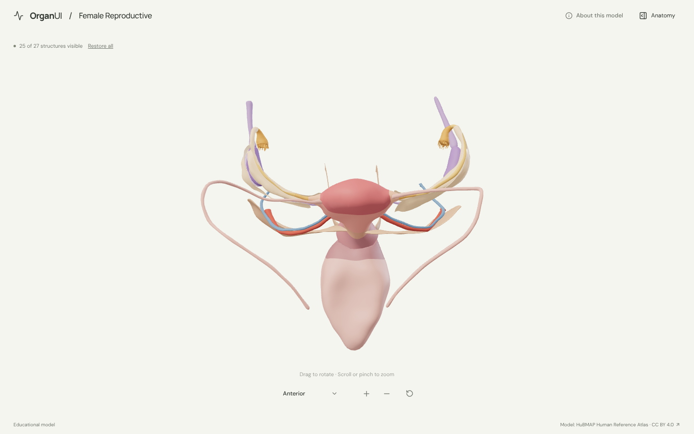
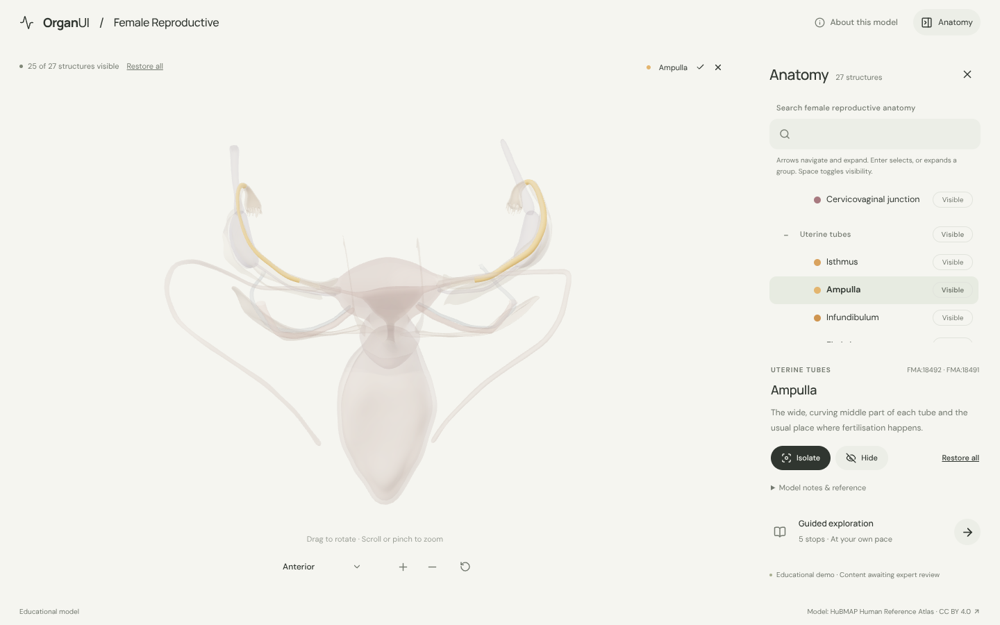
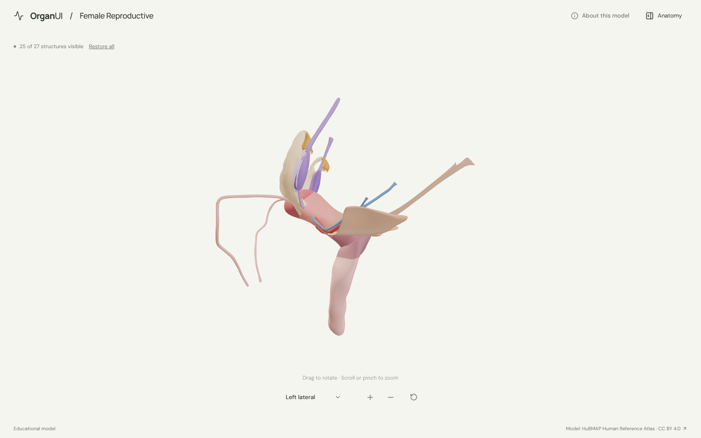
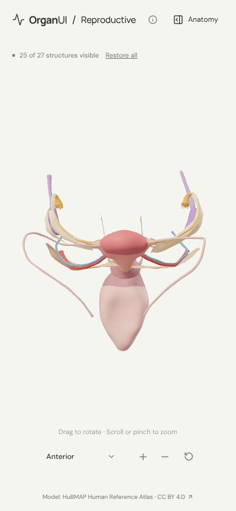

# OrganUI Female Reproductive

A minimal, standalone, open-source explorer of the female reproductive organs (uterus, vagina, uterine tubes, ovaries and their ligaments) built with React, TypeScript, Three.js, React Three Fiber, Vite, and Bun. It shares its interaction design and code with [OrganUI Heart](https://github.com/organui/heart-3d).

**Status:** working local demo. Twenty-seven selectable structures from a real, openly licensed model, responsive layouts, and checked desktop/mobile interactions. Public deployment and clinical anatomy review have not been completed.



## Run locally

Install [Bun](https://bun.sh/) **1.4.2 or newer**, then:

```sh
git clone https://github.com/organui/uterus-3d.git
cd uterus-3d
bun install --frozen-lockfile
bun run dev
```

Open **http://127.0.0.1:5173**. No environment variables, accounts, API keys, sibling repositories, model downloads, or external font services are needed after dependency installation. The ready-to-use 4.0 MB GLB is in `public/models/`.

```sh
bun run typecheck       # TypeScript checks, including conversion scripts
bun run test            # Unit tests for selection emphasis, picking, ownership, starting state and the anatomy-tree adapter
bun run verify:model    # Check the GLB hash, structure IDs, source nodes, and valid geometry
bun run build           # Typecheck and create dist/
bun run preview         # Serve the production build at http://127.0.0.1:4173
bun run format:check    # Check formatting
```

The app is static and uses relative build paths. No deployment has been performed.

## Explore

- The uterus opens centred with the tubes, ovaries, ligaments and uterine vessels around it. The broad ligament and bladder start hidden because they cover the uterus; **Restore all** or the anatomy panel shows them. Open **Anatomy** in the header to browse structures.
- Drag to rotate; scroll or pinch to zoom. The view menu has anterior, superior and left lateral presets. Manual rotation changes its label to **Custom view**; zooming and selecting keep the view name.
- Select a mesh or use the anatomy tree (the OrganUI registry `anatomy-tree` component, see [registry integration](docs/REGISTRY_INTEGRATION.md)). The selected structure glows in its own colour and everything else is ghosted, so the cervical openings and the ovaries stay visible through surrounding tissue.
- Isolate a structure, hide it, or restore all. **Reset explorer** restores the anterior camera, starting visibility, selection, tree state and tour.
- Follow five guided stops: the body of the uterus, the cervix from the side, the uterine tubes, an isolated ovary, and the broad ligament from above.
- Keyboard: Tab/Enter for controls, arrow keys to rotate the focused model, `+`/`-` to zoom, Escape closes the panel and returns focus to its toggle.

<details>
<summary>Selection, lateral view and mobile screenshots</summary>







</details>

## Model, credits, and license

> HuBMAP Human Reference Atlas 3D Reference Object Library, by Kristen Browne, Heidi Schlehlein et al. (HuBMAP, NIH award OT2OD026671), licensed under CC BY 4.0. Adapted by OrganUI.

BodyParts3D, which the other explorers use, was built from a male body and has no female reproductive organs, so this explorer uses the HRA female reference organs segmented from the Visible Human Female: 45 named mesh nodes from 9 source files, grouped into 27 structures. The model data and screenshots of it are under **[CC BY 4.0](https://creativecommons.org/licenses/by/4.0/)**, separately from this repository's **MIT code license**. Files come from a checksum-pinned commit of the atlas's GitHub library, and every node is cross-checked against the atlas's ASCT+B to 3D crosswalk. Read [model provenance](docs/MODEL_PROVENANCE.md), [asset attribution](public/models/ATTRIBUTION.md) and the [manifest](public/models/manifest.json).

Descriptions summarise general anatomy and the [NCI SEER Training female reproductive system page](https://training.seer.cancer.gov/anatomy/reproductive/female/). **Expert anatomical review is pending.** This is an educational interface demonstration, not a diagnostic or clinical tool.

Known limitations:

- The uterus is shown as outer surfaces (fundus, body, cornua, lower segment, cervix). There is no cavity, endometrium or separate muscle layer, and the source's anterior and posterior wall meshes duplicate the body, so they are left out.
- Paired tube parts, ligaments and uterine vessels are selected as one set for both sides.
- The source mesh named "abdominal ostium" sits where the tubes meet the uterus, so it is labelled as the tubal openings. The source's left and right round ligament names are swapped.
- The bony pelvis, rectum, ureters, ovarian vessels, vulva and pelvic floor are omitted. Colours are illustrative.
- Browser checks used headless Chromium with software WebGL at desktop and phone viewport sizes, not physical devices or a screen-reader audit.

## License

Original application code: [MIT](LICENSE). Anatomy model, derived model images, fonts, and icons retain their separately documented licenses.

Part of [OrganUI](https://github.com/organui).
